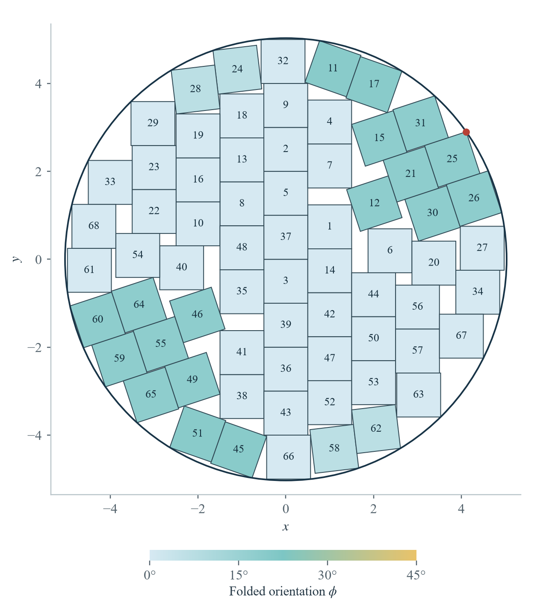

<div align="center">

# Packing 68 unit squares in a circle

**Strict bounds · An exact construction · Reproducible proof certificates**

[中文](README.md) · [English](README.en.md)

[English paper](paper/english/manuscript.pdf) · [Chinese paper](paper/chinese/manuscript.pdf) · [Verification guide](proof/README.en.md)

</div>

Let $r(68)$ be the least radius of a disk containing 68 unit squares with arbitrary real translations and rotations and pairwise disjoint interiors. This repository accompanies the work of ShaneZhang (Shanghai University), providing the manuscripts, an exact construction, and independently checkable finite certificates.

The proved bounds are

$$
\frac{39}{8}<r(68)\le\widehat R<5.031404629453352.
$$

**The exact global optimum, and whether 68 squares fit at radius 5, remain open.** Here $\widehat R$ is the exact enclosing radius of the supplied construction about its specified origin.

<p align="center">
  
</p>

The construction has a largely columnar interior and several rotated groups near the boundary. The red point marks the unique farthest vertex on square 25. Color records folded orientation; the plot is illustrative, while the rational coordinates define the packing.

## Reading and data

| Resource | Contents |
| --- | --- |
| [English paper, 8 pages](paper/english/manuscript.pdf) | Color preprint with the complete argument, three figures and references |
| [Chinese paper, 8 pages](paper/chinese/manuscript.pdf) | Separate Chinese edition in a compact journal layout, with the same bounds |
| [Exact coordinates](proof/upper/best-68-exact-state.json) | 68 rational centers and rational unit direction vectors |
| [Exact radius certificate](proof/upper/best-68-exact-radius.json) | Complete integers $p,q$, the equation $qR^2-p=0$, and an isolating interval |
| [Verification guide](proof/README.en.md) | Exact upper verification, complete lower replay and acceptance criteria |
| [Manuscript sources](paper/README.md) | Both LaTeX editions and the complete English arXiv-format source archive |
| [Results and scope](docs/RESULTS.md) / [Release notes](docs/RELEASE.md) | What is proved, provenance, and checks actually run for this release |

## An exact radius for the construction

The radius is specified by $\widehat R=\sqrt{p/q}>0$, with coprime integers of 1451 and 1450 digits stored in the [radius certificate](proof/upper/best-68-exact-radius.json). Exact integer comparisons establish

$$
\begin{aligned}
5.031404629453350730787899409097&<\widehat R,\\
\widehat R&<5.031404629453350730787899409098.
\end{aligned}
$$

This algebraic number describes the supplied construction. It is not asserted to equal the global optimum $r(68)$ or the construction's minimum enclosing radius after recentering.

## Quick verification

Run from the repository root after downloading or cloning. These checks require only the Python 3 standard library:

```sh
python -B tools/check_integrity.py
python -B proof/upper/verify-upper.py proof/upper/best-68-exact-state.json --radius proof/upper/best-68-exact-radius.json
python -B proof/upper/verify-upper.py --self-test
python -B proof/lower/verify-lower.py --check-inputs
python -B proof/lower/test-wrapper.py
```

The complete upper check reports `PASS_EXACT_68_SQUARE_UPPER_BOUND`. It rechecks all 272 vertices and 2278 unordered square pairs, derives the maximum squared vertex distance, and validates the radius equation and isolating interval.

The lower `--check-inputs` command checks frozen inputs, the covering tree and the exact cost comparison; **it does not evaluate integrals**. Small control tests are also separate from a complete lower-bound replay. To replay the complete lower certificate:

```sh
python -m pip install -r proof/lower/requirements.txt
python -B proof/lower/verify-lower.py
```

The dependency is pinned to `python-flint==0.8.0`. Only `PASS_GLOBAL_REAL_R68_LOWER_GRADIENT` together with `fresh_full_replay: true` confirms a new complete replay. See the [guide](proof/README.en.md) for resource settings, dependencies and failure criteria. Do not use Python `-O` or `-OO`.

## Evidence and limitations

The lower bound uses a nonnegative radial weight on 80 annuli and a complete 11837-leaf cover of a continuous pose domain. Rotation invariance and the reductions proved in the paper extend the certificate to all real translations and rotations. The computation relies on exact rational arithmetic and outward-rounded Arb enclosures.

This GitHub release freshly runs the complete upper check, lower-input preflight and small controls. It preserves the historical complete lower replay; **the integral replay was not rerun during this packaging step**. The [release check record](validation/release-checks.json) distinguishes these cases. This is a computer-assisted proof, not a proof-assistant formalization. No current world-record or exhaustive priority claim is made.

## Citation and use

> ShaneZhang. *Strict bounds for packing 68 unit squares in a circle*. Preprint, 2026.

This archive supplies a preprint and verification materials; it does not assign a published journal reference, DOI or arXiv identifier. [CITATION.cff](CITATION.cff) provides a citation for the research archive. See [RIGHTS.md](RIGHTS.md) for the rights status.

Large language models assisted proof exploration, code preparation, literature review and writing. The mathematical arguments and checkable certificates are the stated evidence. Please report errors through repository Issues with a precise location or a reproducible failing case.
