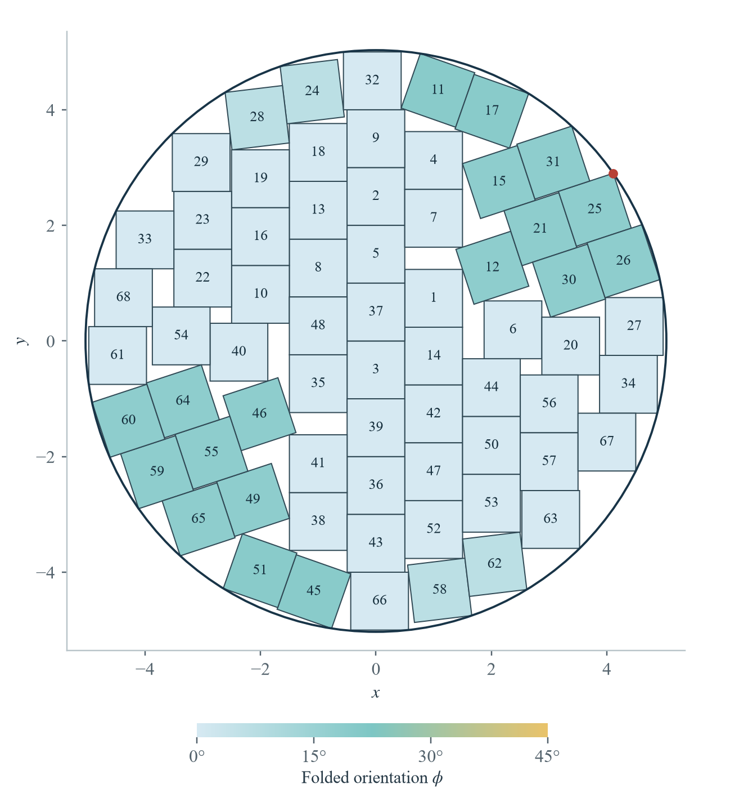

<div align="center">

# 圆内 68 个单位正方形装箱

**严格上下界 · 精确构造 · 可复核的计算机辅助证书**

[中文](README.md) · [English](README.en.md)

[英文论文](paper/english/manuscript.pdf) · [中文论文](paper/chinese/manuscript.pdf) · [中文复核说明](proof/README.zh.md)

</div>

研究允许任意实数平移和旋转、内部互不相交的 68 个单位正方形，所需圆盘的最小半径记为 $r(68)$。本仓库汇集 ShaneZhang（张世逸，上海大学）的论文、精确构造及其复核材料。

已证明的范围是

```math
\frac{39}{8} \lt r(68) \leq \widehat R \lt 5.031404629453352.
```

**$r(68)$ 的精确最优值，以及半径 5 能否容纳 68 个单位正方形，仍未解决。** $\widehat R$ 是本仓库给出的明确构造关于指定圆心的精确外接半径。

<p align="center">
  
</p>

图中为经精确有理算术验证的 68 块构造。内部以列状排列为主，边界附近包含若干旋转组；红点标记第 25 块的唯一最远顶点。颜色表示折叠朝向，图形用于展示，精确坐标才是构造定义。

## 先读什么

| 材料 | 内容 |
| --- | --- |
| [英文论文（8 页）](paper/english/manuscript.pdf) | 彩色预印本，完整数学论证、三幅图及参考文献 |
| [中文论文（8 页）](paper/chinese/manuscript.pdf) | 独立中文彩色预印本，与英文统一 A4 版式，含三幅中文标注彩图 |
| [精确坐标](proof/upper/best-68-exact-state.json) | 68 个有理中心和有理单位方向向量 |
| [精确半径](proof/upper/best-68-exact-radius.json) | 完整整数 $p,q$，方程 $qR^2-p=0$ 及隔离区间 |
| [中文复核指南](proof/README.zh.md) / [English guide](proof/README.en.md) | 上界独验、下界完整重放和成功判据 |
| [论文源码与编译说明](paper/README.md) | 两版 LaTeX 源码、英文 arXiv 格式源码包及含中文字体的完整源码包 |
| [成果范围](docs/RESULTS.md) / [发布说明](docs/RELEASE.md) | 证明对象、证据来源和本次实际执行的检查 |

## 精确半径

本构造的半径由 $\widehat R=\sqrt{p/q}>0$ 精确指定，其中互素整数 $p,q$ 分别有 1451 位和 1450 位，完整值保存在[半径证书](proof/upper/best-68-exact-radius.json)中。其严格隔离区间为

```math
\begin{aligned}
\widehat R &\gt 5.031404629453350730787899409097,\\
\widehat R &\lt 5.031404629453350730787899409098.
\end{aligned}
```

这个精确代数数描述所给构造；它不被宣称为全局最优 $r(68)$，也不被宣称为该构造重新选择圆心后的最小外接半径。

## 本地快速复核

下载或克隆仓库后，从仓库根目录运行。以下检查只需 Python 3 标准库：

```sh
python -B tools/check_integrity.py
python -B proof/upper/verify-upper.py proof/upper/best-68-exact-state.json --radius proof/upper/best-68-exact-radius.json
python -B proof/upper/verify-upper.py --self-test
python -B proof/lower/verify-lower.py --check-inputs
python -B proof/lower/test-wrapper.py
python -B proof/lower/test-entrypoints.py
```

完整上界检查的成功状态为 `PASS_EXACT_68_SQUARE_UPPER_BOUND`：它重新检查全部 272 个顶点、2278 对正方形、精确半径方程与隔离区间。

下界的 `--check-inputs` 仅检查冻结输入、覆盖树和精确收费比较，**不计算积分**；小型控制测试也不等于完整下界重放。完整重放需要 `python-flint==0.8.0`，入口为：

```sh
python -m pip install -r proof/lower/requirements.txt
python -B proof/lower/verify-lower.py
```

只有完整运行输出 `PASS_GLOBAL_REAL_R68_LOWER_GRADIENT` 且 `fresh_full_replay: true`，才表示本次重新完成了下界证书验证。完整参数、依赖与资源说明见[复核指南](proof/README.zh.md)。请勿使用 Python 的 `-O` 或 `-OO`。

## 证据与边界

下界使用 80 个圆环上的非负径向权重，对连续姿态域的 11837 个叶子完成覆盖验证；旋转不变性和论文中的归约将其用于所有实数平移和旋转。这里的依据包括数学论证、精确有理算术以及 Arb 向外舍入区间运算。

v2 已执行完整上界检查和**完整下界积分回放**：11,837 个叶子全部通过，超算作业 126395001 为 `COMPLETED / 0:0`，并修复了验证入口。当前 v3 统一中英文彩色预印本的版式，保留全部 27 个证明文件的原始字节，未重复数学计算。两版各 8 页、三幅彩图，均已逐页检查。详见 [v3 修订说明](docs/REVISION-v3.md)、[v2 验证修订](docs/REVISION-v2.md)及[发布检查记录](validation/release-checks.json)。[v1](https://github.com/chromoany/r68-square-packing/tree/v1.0.0) 和 [v2](https://github.com/chromoany/r68-square-packing/tree/v2.0.0) 均完整保留。本工作属于计算机辅助证明，并非 Lean/Coq 等证明助理的形式化证明；没有宣称当前世界纪录或文献优先权。

## 引用与使用

> ShaneZhang. *Strict bounds for packing 68 unit squares in a circle*. Preprint, 2026.

本仓库包含预印本及验证材料，未标注已发表期刊卷期、DOI 或 arXiv 编号。可用 [CITATION.cff](CITATION.cff) 引用该成果归档。论文和代码的权利说明见 [RIGHTS.md](RIGHTS.md)。

大语言模型参与了证明探索、程序准备、文献查阅和写作；结论的依据以论文中的论证和随附可检查证书为准。如发现错误，请通过仓库 Issues 提供具体位置或可复现的失败案例。
